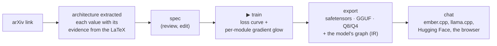
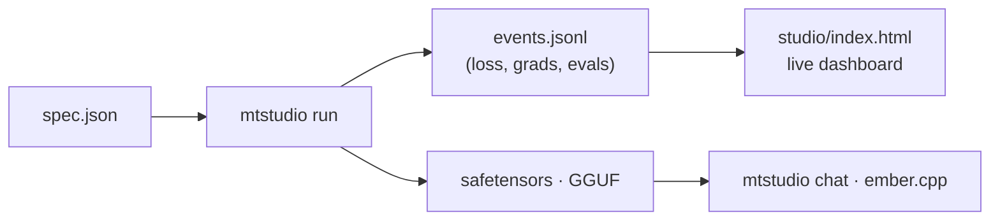

# paperkiln

**Drop an arXiv link on a page. Train the paper's actual architecture, not the nearest
preset. Watch its gradients glow layer by layer, export a GGUF, and chat with it. One browser
tab, one C++ stack you can read in an afternoon, and every claim carries its receipt.**

*Formerly `microtorch` (renamed 2026-08-01; GitHub redirects the old URL). The C++ namespace and
header paths keep `microtorch`. Sibling engines: [ember.cpp](https://github.com/JohnnyTeutonic/ember.cpp)
(inference) and [coalfire.cpp](https://github.com/JohnnyTeutonic/coalfire.cpp) (the original C++ trainer).*

**[▶ Watch the 5-minute walkthrough](docs/media/demo_walkthrough.mp4)**: the whole loop, live
and unedited. It shows the arXiv fetch on camera, the evidence view, training, export and chat.




## What it is

A readable C++ LLM training stack (reverse-mode autograd and hand-derived backwards) that trains
real architectures end to end, from paper to served model. It publishes negatives next to its wins.
The core engine (tape, ops, layers, Llama family, quantisation, GGUF) is ordinary C++ with scoped CTest and Python
suites; supported behaviour and numerical limits are recorded beside the tests and receipts.

Gradient checks include finite differences for differentiable primitives. BitLinear uses a
straight-through estimator: its surrogate gradients are tested against their specified rules,
rather than finite differences of the discontinuous quantized forward.

| Area | What you get |
|---|---|
| **Model families** | Llama (RMSNorm, RoPE, SwiGLU), GPT-2, flex (any depth, norm, activation, positions; paper-faithful), sliding-window attention with sinks, Kimi linear attention, Mamba-style state space, SRD, AttnRes, highway, **mixture of experts** (top-k, load-balance + z-loss, sparse upcycling); on the Llama block: tied-block **recursion** and **Mixture-of-Recursions** (per-token depth, causal), **per-turn state tokens** (a turn-state attention mask, KV eviction of finished turns) and attention residuals across sublayers |
| **Conversations** | one schema for instruction tuning and chat (an instruction is a one-exchange conversation; a system message folds into the first user message); the loss policy declared per run (by default every assistant turn); the chat template written into every GGUF as a versioned record, with a generated `tokenizer.chat_template` and an Ollama Modelfile, so llama.cpp, LM Studio and Ollama prompt a 16k-vocabulary model exactly as paperkiln and ember.cpp do; opt-in, the export writes ember's draft table for the chat model, built from the conversations it was trained on (`export.draft_table`), for speculative decoding at about twice plain decode |
| **Runtime-defined ops** | a paper's new activation, gate or norm variant written as an `expr` (`"activation": "expr:max(x, 0)^2"`): parsed at runtime into differentiable primitives, gradient-checked, trained and exported as an IR node without recompiling; ember.cpp runs the same grammar. C++ vs the numpy reference within 1.2e-7 |
| **Any architecture, both directions** | every family exports its graph as IR; and standard llama.cpp GGUFs of Qwen2/Qwen3, Gemma 3, GPT-2, GPT-NeoX (Pythia), Mistral (sliding window) and Mamba-1 get an IR built from their metadata (`spec/tools/gguf_ir.py`), run by a numpy reference interpreter (`spec/tools/ir_numpy.py`) and gated against Hugging Face transformers (`tools/thirdparty_parity.py`: GPT-2 124M and Pythia-160m 40/40 greedy); ember.cpp runs them, Qwen2.5 and Qwen3 40/40 vs HF |
| **Training** | AdamW, SGD, **Muon**; warmup + cosine; mini-batching, gradient accumulation, checkpointing, fused attention; LoRA and QLoRA (int8); **CUDA** device-resident step (L4: 0.109 s/step at d384, from 6.4); **BF16 mixed precision** and flash attention, opt-in (`train.precision`, `train.attention_kernel`): the complete ten-shape L4 profile records 1.34-2.09x for the combination in single descriptive measurements ([results](docs/receipts/bf16_profile_20261030/RESULTS.md)); the separate seeded loss/noise gate is retained |
| **Post-training** | masked SFT, rejection SFT, GRPO, DPO + RPO; AI-judged preference data: candidate replies sampled through ember (`tools/posttrain/sample_candidates.py`), a Claude judge ranking both orders under a hard cost cap, and a 200-prompt pilot (`experiments/chat_general/judge_pilot.sh`) |
| **Data** | pinned corpora with ledgers and hashes: FineWeb-Edu (shard 0; shards 1-3 are pinned on their first fetch), dialogue for pretraining (SODA, OpenAssistant, UltraChat, everyday-conversations; `corpus/fetchers/dialogue_pt.py`), a large SFT set from smol-smoltalk (`tools/lever1_sft.py`); the dialogue and SFT sources checked against the frozen eval sets (`corpus/decontam.py`); a two-part mixer with an annealing tail (`corpus/mix_pretrain.py`); pre-tokenised `.ids` corpora (`tools/corpus_ids.py`) |
| **Tokenisers** | paperkiln's byte-level BPE, and a llama.cpp-compatible vocabulary in the Llama 3 scheme: a trainer (`corpus/fetchers/vocab_llama3_bpe.py`) whose check compares ids with llama.cpp's own tokeniser, and an exact C++ encoder ported from llama.cpp (`include/microtorch/llama3_tokenizer.hpp`) |
| **The IR** | the graph format both engines share, specified in **keramos** (its own repository; vendored here at a pinned tag in [`spec/`](spec/), `spec/KERAMOS_PIN.json`): IR version 1, specification revision 1.6 (vendored tag v1.6.0), with profiles core, state, recursion, chat, thirdparty and recurrence (a per-token state update declared in the document); every op EXACT (bit-identical on every backend) or ROUNDING (within a stated tolerance); the document's digest (RFC 8785 + SHA-256, `paperkiln.ir_sha256`); exact values for every stored tensor type; a JSON Schema, a validator, a numpy reference interpreter and a conformance suite that any engine joins through a JSON Lines adapter ([`spec/README.md`](spec/README.md)) |
| **Export** | safetensors (HF round trip), Hugging Face `from_pretrained` folders, GGUF with the tokeniser embedded, **Q8_0 and 4-bit (Q4_0, Q4_K_M, Q4_K_S) GGUFs** (byte-identical to the reference quantisers), and the **model graph as IR** in every GGUF, so [ember.cpp](https://github.com/JohnnyTeutonic/ember.cpp) runs every family; opt-in, **ember's corpus draft table** beside a chat model's GGUF (`export.draft_table`, `tools/draft_table.py`: the most frequent next token per context of up to 4 tokens of its own SFT text, byte-identical to ember's builder; `EMBER_DRAFT=table` speculation is 1.9-2.2x plain decode on chat on an L4, replies unchanged) |
| **Studio** | one JSON spec runs train → eval → export → serve; a zero-dependency dashboard with live loss, gradient glow, spec builder, architecture diagram, from-paper flow and chat; clone a full saved spec with one typed change, overlay two saved event logs, and explore typed-factor sweep heatmaps without uploading files |
| **From papers** | **LLM extractor** (`papers/llm_extract.py`): one Claude call reads the paper's LaTeX and returns the architecture as an IR op graph, new operations as runtime-defined `expr` ops, and a verbatim quote for every value; a deterministic verifier checks each quote against the source before anything trains. On the 40-paper benchmark (27 Oct prompt): flavours 81 correct, 11 abstain, 0 wrong, against the rule-based extractor's 73 / 19 / 0; sizes 569 / 2 / 71 against 136 / 8 / 498. The rule-based extractor (`papers/fetch.py` / `pip install paperkiln-fetch`, no API key) stays as the offline path |
| **Research tooling** | the Architecture Atlas (designed experiments, multi-seed cells, a findings registry with retractions), falsifiers built into the modules, one-command replication |

Experimental GPT2 training can opt into `train.attention_precision: "bf16"` for exact two-block `gpt2-nano` LM/SFT with FP32 projections. This is a per-model training recipe: score, sample, chat and exported inference remain FP32. CPU default-bit, gradient, save/reload and NumPy/Ember inference checks pass; CUDA model validation and performance remain open. The VRAM planner refuses this uncalibrated mode. [Scope and evidence](docs/receipts/gpt2_attention_precision_20261031/RESULTS.md).

## Current results and limits

The [registered five-seed size comparison](experiments/tiny_chat_2026-10/size/RESULTS.md)
is complete: under its fixed-token, eight-layer protocol, the primary carry-score slope across
20M/60M/150M meets the registered practical-equivalence rule. Language-model loss improves
with size, but this particular conversational-memory score does not. This is a scoped result,
not a general scaling limit or a state-of-the-art comparison. Carry-12's three-seed core and
its completed five-seed HS1 follow-up are recorded separately in
[the long-conversation results](experiments/tiny_chat_long_2026-10/RESULTS.md).
A new historical-source CUDA scorer reproduces all six full-history reply disagreements
at runner-up near-ties. The generation replay did not execute, so the complete historical
cause remains unresolved ([scorer evidence](experiments/tiny_chat_long_2026-10/receipts/parity_diagnosis_20261031/operational_attempt2/parent_replay.json)). The registered
S-full control is prepared but unlaunched; its independent
[review](docs/receipts/sfull_independent_review_20261031/review.json) distinguishes
completed analysis from a clean scientific validity pass.

HF interoperability now includes faithful native BPE and supported legacy tokenizers, complete
source-tensor checks, greedy IDs and raw logit checks. New verifier receipts retain the rows
for offline numerical replay; an existing tiny flex fixture reproduces all24 IDs and its
8.94e-8 maximum logit difference ([retained evidence](docs/receipts/hf_raw_evidence_20261030/README.md)).
This does not validate every architecture modifier, chat template or downstream task.

Tiny composed Mamba1 CPU and actual-L4 checks cover all 1,224 parameter derivatives
across one- and two-block fixtures against independent binary64 equations and central
differences ([CPU](docs/receipts/mamba1_composed_fd_20261031/parent_replay.json),
[CUDA](docs/receipts/mamba1_composed_cuda_20261031/parent_replay.json)). Mixed host paths
remain; these fixed tiny-network checks establish no quality, speed or full residency result.

The computed-table embedding host fallback now has an actual L4 old-failure reproduction
and seven passing fixed/control cases ([raw replay](docs/receipts/embedding_fallback_cuda_20261031/parent_replay.json)).
This closes a conditional boundary, alongside the separately verified activation and norm fallbacks.

The NT tiled-GEMM load path passes 96 bitwise/reference cases and a prospective paired
kernel timing gate: about 25% faster at the tested 256³ shape, with the other modes
unchanged ([results and rejected broader version](docs/receipts/gemm_nt_cuda_20261031/RESULTS.md)).
This is a kernel result, not whole-model throughput.

Open engineering and research work is listed in [ROADMAP.md](ROADMAP.md). In particular,
the BF16 attention op and experimental train-only GPT2 subset pass bounded actual-L4 model
and host NumPy/Ember correctness checks ([model receipt](docs/receipts/gpt2_attention_precision_20261031/gpu_v2/parent_model_replay.json)).
Model quality, speed and adoption remain unestablished; modified-flex HF exports and remaining
device/host boundaries stay explicitly scoped.

## What makes it different

1. **Papers in, running models out, with provenance.** An LLM reads the paper; every value it
   returns carries the sentence, equation or table cell it came from, and a deterministic check
   confirms that quote is in the LaTeX before the value is used. Unresolved fields are reported,
   never guessed, and a new operation the paper proposes comes back as an `expr` op both
   engines run without recompiling.
2. **The paper's architecture is what trains.** Depth, d_ff, norm, activation and positions
   are constructor-real. *Attention Is All You Need* trains as 512/6/8/2048 with LayerNorm,
   ReLU and sinusoidal positions.
3. **The extraction is measured.** A 40-paper benchmark with ground truth, CIs and a growth
   protocol scores both extractors side by side, with every call's tokens and cost receipted.
   Every wrong assertion it found is registered with its cause and fixed.
4. **Falsifiers ship inside the modules,** and failed claims are
   [published](docs/SPARSE_ATTENTION.md).
5. **The loop closes across two engines.** Models export to GGUF and run in ember.cpp, a
   separately written engine, with replies identical token for token. The live demo is
   [a model trained here](https://huggingface.co/spaces/johnnyteutonic/ember-chat), running in
   the browser.
6. **It runs designed experiments on itself.** The [findings registry](atlas/FINDINGS.md) holds
   35 findings, 3 retractions and 4 supersessions among them. 18 carry a manifest that
   `python tools/reproduce.py <id>` re-runs.

## Quick start: chat with your own model

```bash
git clone https://github.com/JohnnyTeutonic/paperkiln.git && cd paperkiln
bash quickstart_chat.sh
```

The script checks your tools (and tells you how to install anything missing), builds
paperkiln, makes a practice corpus, trains a model on your CPU (about 10 minutes for the Quick
preset), writes a plain-language model card and opens a chat page at http://127.0.0.1:8080. It
can also make a temporary public link. Linux, macOS and Windows through WSL2. `--mode default`
skips training and chats with the ready-made browser model. Scripted flags:
`--mode default|train --preset quick|better --share|--no-share --port N --yes|-y`.

## Quick start: train from a spec

```bash
mkdir build && cd build && cmake .. -DCMAKE_BUILD_TYPE=Release && make -j mtstudio && cd ..
pip install huggingface_hub gguf transformers torch tokenizers safetensors
python tools/get_tinystories_data.py                   # public corpus + vocabulary
./build/mtstudio run specs/tinystories-llama-3k.json   # train, eval, export safetensors + GGUF
./build/mtstudio chat runs/tinystories-llama-3k --port 8080
```

One JSON file describes the run (`arch`, `data`, `train`, `export`, `serve`): see
[specs/](specs/) and [the spec format](docs/TOUR.md#custom-configuration--the-spec-format).
`mtstudio plan` dry-runs it, and runs resume from their checkpoints.



## Quick start: from an arXiv paper

```bash
export ANTHROPIC_API_KEY=...                                        # the LLM extractor's only credential
python papers/llm_extract.py extract 2302.13971 --out llama.extraction.json
python tools/arxiv_to_chat.py 2302.13971 --extraction llama.extraction.json --run-dir runs/llama \
    --chat "Hello, how are you?"                                     # paper -> trained model -> chat
```

`llm_extract.py` sends the LaTeX in one call (about $0.3-0.5 a paper with Claude Opus), verifies
every quote, and writes the `extraction.json` that `tools/arxiv_to_chat.py` trains from; anything
unverified or outside the IR makes the chain refuse rather than approximate. Without an API key,
the rule-based extractor does the same job more conservatively:

```bash
pip install paperkiln-fetch
paperfetch 1706.03762                       # evidence-carrying architecture summary
paperfetch 2302.13971 --emit-hf cfg.json    # a Hugging Face config, citations inside
```

In the studio (`./build/mtstudio serve <out_dir> 8080`, then open the page), drag an arXiv link
onto the page. In rule-based mode, the extracted architecture fills the spec builder and
the diagram redraws; ▶ train runs in the same tab. LLM mode opens the evidence review described
below. Details: [the LLM extractor](docs/TOUR.md#paper-to-architecture-the-llm-extractor)
and [the rule-based fetcher](docs/TOUR.md#paper-to-architecture-the-rule-based-arxiv-fetcher-no-api-key).

For LLM extraction in Studio, install the optional `anthropic` and `requests` Python packages
and configure `ANTHROPIC_API_KEY` in the server's environment before starting it. Studio never
searches dotenv files or receives the key through the browser. The LLM mode has an explicit
per-job spend cap (up to $5), status and cancellation; a request already sent to the provider
may still be charged after cancellation. Results show source evidence, verification failures,
unresolved values and mechanism blockers, with the original extraction available for download
and the `arxiv_to_chat.py --extraction` handoff. The coarse form builder stays unchanged rather
than approximating unsupported mechanisms. Rule-based extraction remains a separate, explicitly
selected mode; an LLM failure never switches to it. Tests and cached verifier checks require no key.

The **Research** panel also works by opening `studio/index.html` directly. Load a complete
`saved spec.json`, choose one existing parameter and enter a value of the same JSON type.
Download the clone, review its new name/output folder, then use `mtstudio run clone.json`.
The original file and every other setting are preserved; creating the clone does not start
training. Load two saved `events.jsonl` files to overlay their train losses and validation
points and compare counts, last/best loss and completion status. Backward/repeated steps
break the trace and are flagged instead of joining separate training segments. Files are
processed locally (50 MiB per file); no model or server call is made by this panel.

Contract checks: `node --test tests/test_studio_research.js`. The optional installed-Chrome
smoke is `node tests/studio_research_browser.js OUTPUT_DIR` with Playwright available to Node
(`STUDIO_CHROME` can select an executable). Its default spec/logs are synthetic; the saved
30 October receipt additionally verifies that a downloaded real six-step clone trains and exports.

The **Sweep heatmap** loads `cells.jsonl` from `tools/mtsweep.py`. Select distinct row and
column factors and a fixed value for each remaining factor. Cells show the saved validation
mean, seed count and population standard deviation; hover for the full precision and cell ID.
Unobserved combinations, zero-seed cells and multiple distinct cells at one coordinate remain
explicit and are not pooled or interpolated. The initial slice contains an actual recorded
cell. These aggregate files do not prove planned seed coverage or statistical significance.
The viewer accepts up to 50,000 records and 900 displayed grid positions. Its contract test is
`node --test tests/test_studio_sweep.js`; optional Chrome smoke:
`node tests/studio_sweep_browser.js OUTPUT_DIR` (same Playwright setup).

## Quick start: export and serve anywhere

```jsonc
"export": { "formats": ["safetensors", "gguf", "gguf_q8_0_all", "gguf_q4_k_m"] }
```

`mtstudio export spec.json --from model.safetensors --formats ...` re-exports an existing
checkpoint. Every GGUF carries its tokeniser and the model's graph (`paperkiln.ir`).

For a chat model, `"draft_table": true` in `export` also writes `<name>.draft_table.bin` (and its receipt
`.json`) from `data.sft_examples`, or `{"sources": [...], "max_bytes": N}` from the chat text you name
(`.txt` in the chat format, or JSONL rows). ember serves it with `EMBER_SPEC=8 EMBER_DRAFT=table
EMBER_DRAFT_TABLE=<name>.draft_table.bin`. Off by default; without it nothing in the export changes.
`python tools/draft_table.py build --gguf model.gguf --out model.draft_table.bin sft.jsonl` builds one for
an existing model.

- [ember.cpp](https://github.com/JohnnyTeutonic/ember.cpp) runs every family (CPU, CUDA,
  WebAssembly), and llama-family and MoE models on the visitor's GPU in the browser (WebGPU).
- llama.cpp runs the llama, MoE and gpt2 exports, given token ids. Models on the new Llama 3
  scheme vocabulary tokenise in llama.cpp, Ollama and LM Studio too.
- `python tools/hf_export.py <run> --hf-dir <dir>` writes folders that
  `transformers.from_pretrained` opens for supported plain Llama, GPT-2 and plain
  Llama/GPT-2 Flex mappings, including explicitly tied Flex output heads
  and explicitly recorded exact GELU or ReLU in GPT2 Flex.
  ReLU parity is scoped to finite execution: native ReLU masks NaNs and clears
  negative zero, while HF preserves them; the exceptional-value differences are
  documented and tested. Unsupported modifiers refuse rather than silently approximate.
  Exports stage completely before publication; replacing managed files requires `--overwrite`.
  Unrelated files are preserved. Replacement of an existing export is rollback-protected,
  not crash-atomic; stale shards or loader overrides refuse rather than being silently deleted.
  `python tools/hf_export_verify.py <dir> <run> --spec <spec.json> --receipt parity.json`
  checks source tensors, prompt IDs, greedy IDs and raw logits. It retains hashed float32 rows
  beside the immutable receipt. `python tools/hf_export_verify.py --replay parity.json`
  recomputes the retained numerical/greedy checks using NumPy, without loading models.
  Offline replay checks those saved rows; it does not repeat model execution or validate chat rendering.

The Kimi/SRD/recurrence presets accept positive `arch.custom.layers` values;
the two-layer default and existing checkpoints are preserved. CPU training,
export and independent Ember/NumPy parity are checked at one and three layers.
Here Kimi denotes the existing channelwise ELU mixer, not the published KDA
architecture. [Depth validation](docs/receipts/parity_depth_20261031/cli_validation.json).

At measured revision `1b0102709` (integrated as `d960e78bc`), on an Intel
i9-13905H under WSL2 with one CPU thread, contiguous host LayerNorm
indexing measured a 3.66x geometric mean speedup over a fixed 16-case operation
set and 1.279x on a tiny d16, L2, T16 teacher-forced scoring workload (eight ABBA
blocks). Operation outputs, gradients, SGD updates and score logits remained
bit-identical. These measurements do not establish general training or GPU speed.
[Validation and replay evidence](docs/receipts/cpu_layernorm_20261031/validation.json).
The subsequent LayerNorm fallback coherence fix materializes stale x/gamma/beta
before host reads, including backward gamma when dX needs it. Four isolated L4
CUDA+DEVCHECK cases reproduce the original failures and pass after the fix. This
newer binary has not been retimed; the figures above belong to the measured
revision. [Coherence evidence](docs/receipts/layernorm_coherence_cuda_20261031/validation.json).

## Quick start: GPU

```bash
mkdir -p build && cd build && cmake .. -DCMAKE_BUILD_TYPE=Release -DMICROTORCH_CUDA=ON && make -j mtstudio && cd ..
export MICROTORCH_DEVICE=cuda MICROTORCH_DEVICE_OPS=1 MICROTORCH_ATTN_BLOCKED=1 MICROTORCH_CUBLAS=1
export MICROTORCH_STEP_RESIDENCY=1 MICROTORCH_DEFER_DOWNLOADS=1   # llama family only: leave out for gpt2
./build/mtstudio run spec.json
```

Each switch is opt-in. `MICROTORCH_DEVICE=cuda` on its own sends the matrix multiplies to the
GPU one call at a time; the full set runs the training step device-resident: resident tensors,
tiled attention, fused SwiGLU, clip and AdamW on the device, and MoE routing kernels. That way
d384 L6 trains at 0.109 s/step on an L4 (from 6.4), and d768 L12 at 2.1-2.3 s/step on a laptop
RTX 4060. Deferred downloads work for the llama family; the gpt2 family is still open
([CUDA_PHASE_B2.md](docs/CUDA_PHASE_B2.md)).

For experimental BF16 attention training on a plain **two-block GPT2** LM/SFT spec,
set `train.attention_precision` to `"bf16"`, keep `train.precision: "fp32"` and the tiled
attention kernel. Other model paths, Flash and activation checkpointing are refused.
Saved scoring, chat and exports use FP32 attention. The fixed tiny actual-L4 gate
passes correctness; quality and speed benefits remain unestablished.
[Recipe, restrictions and evidence](docs/receipts/gpt2_attention_precision_20261031/RESULTS.md).

Mamba causal convolution and ordered selective scan now have CUDA forward/backward kernels.
The 120 convolution cases and 220 scan cases pass actual L4 CUDA + DEVCHECK gates, including
deferred data, sequence boundaries, all gradient masks and independent raw replay. Scan time
is still sequential; B gradients retain extra O(T*D*N) scratch. Whole-model residency and
end-to-end speed remain unestablished. [Convolution evidence](experiments/conv1d_cuda_20261031/receipts/l4_gate_v1/replay.json);
[scan evidence](docs/receipts/selective_scan_cuda_20261031/result.json).

The two tiny composed `parity::MambaLM` Mamba1 graphs (depths 1 and 2, batch 2 × 4,
width 8) also pass an actual L4 CUDA + DEVCHECK gate. All 1,224 parameter gradients
agree with independent binary64 NumPy equations and central differences; required
GEMM, RMSNorm, convolution and scan profile counts are present. This is a composed
graph derivative check: CLI GPU training/save/export, quality, whole-model residency
and speed remain open. `A()` exp/scale and initial embedding-gradient scatter still
use host paths. [Composed Mamba1 evidence](docs/receipts/mamba1_composed_cuda_20261031/result.json).

Deferred CUDA GRPO sampling and reference log-probabilities now materialize
logits before their host reads. Actual L4 regressions reproduce both old failures
and verify the repaired CLI helpers, including sampled IDs and RNG advancement.
[Device evidence](experiments/grpo_host_reads_20261031/receipts/l4_gate_v1/replay.json).
This establishes the two reader fixes, not a training-quality improvement;
[historical runtime applicability](docs/receipts/host_read_followup_20261031/grpo_historical_applicability_20261031.json)
remains unresolved where the old metadata are missing.

## Quick start: C++ and Python

```cpp
#include "microtorch/nn.hpp"
using namespace microtorch;
nn::GPT2 model(nn::GPT2Config{}, /*seed=*/42);
nn::AdamW opt(model.parameters(), 3e-4f);
Var loss = ops::cross_entropy(model.forward(ids), targets);
opt.zero_grad(); backward(loss); opt.step();
```

```bash
pip install paperkiln          # Linux x86-64 wheels, Python 3.10-3.12; import microtorch
```

## Research programme: tiny chat from scratch

How small can a language model be and still hold a conversation? This programme trains 5M-150M
parameter models from scratch for multi-turn chat with a little general knowledge, under rules
fixed before any run: **human-written text only** (13 pinned dialogue sources, no output from
larger models, no distillation), pre-registered hypotheses, seeds and analysis
([experiments/tiny_chat_2026-10/PREREGISTRATION.md](experiments/tiny_chat_2026-10/PREREGISTRATION.md)).

- **The benchmark measures carry, not fluency.** [Carry-5](docs/TOUR.md#evaluating-a-tiny-chat-model-carry-5)
  (1,032 items) plants a fact, a correction, a topic or a standing instruction early in a
  five-turn conversation and asks about it later, scored by forced choice. Each item also runs as
  a single-turn *twin* holding the same information, so the primary metric separates carrying
  context across turns from reading a fact once. Carry-12 (1,452 items, 12-14 turns) extends it to
  long conversations.
- **The questions.** How much dialogue the pretraining mix needs (E5: 0, 17, 35 and 70%); whether
  depth beats width at matched parameters for sequential, turn-by-turn reasoning (E1: 2 to 32
  layers at 20M and at 60M); whether reusing layers helps (tied-block recursion, and
  Mixture-of-Recursions with per-token depth); and whether early training ranks predict final
  ones. For long conversations: per-turn state tokens that let finished turns leave the KV cache,
  and attention over earlier layers' outputs (attention residuals).
- **Built for it, in both engines.** Recursion, Mixture-of-Recursions (causal token choice, so
  every token's depth is decided from what it has seen), per-turn state tokens with their
  attention mask and KV eviction, and attention residuals: each is in paperkiln's trainer, the IR
  spec ([`include/microtorch/ir.hpp`](include/microtorch/ir.hpp)) and ember.cpp's interpreter,
  gated token for token between the two.
- **Status (25 Oct 2026).** The floor pilot passed: a 20M model reads facts planted in a
  conversation (single-turn twin accuracy 0.53, chance 0.25, gate 0.35). E5, E1 at 20M and the
  recursion arm run on Colab; E1 at 60M runs on RunPod. The same pilot run on both providers
  matches bit for bit in pretraining. Arm X5 (attention residuals on the 20m_L16 llama, Jonathan's
  cross-layer idea, amendment 5) runs on RunPod: it trains at 0.67x the plain model's speed, and the
  plain path at its commit is bit-identical to E1's. Results land in the
  pre-registration's folder with their receipts.

## Research: what the methodology found

Run five copies of an identical experiment, varying only the seed. Does sliding-window
attention beat exact attention?

| budget (steps) | verdicts exact / swa | P(two one-seed labs contradict) |
|---:|:---:|:---:|
| 400 | 0 / 5 | 0% |
| 1600 | 1 / 4 | 32% |
| 2000-3600 | 3 / 2 | **48%** |

Single-seed ablations are lottery tickets ([the exhibit](atlas/SEED_LOTTERY.md)). The
[crossing theorem](atlas/THEOREM_CROSSING.md) explains why: for every finite seed budget there
is a band of training budgets where the comparison has no answer, and it narrows only as √n.
Findings live in [the registry](atlas/FINDINGS.md), each with effect, SE, scope and receipts.

```bash
python tools/atlas_findings.py render                 # the registry as a table
python tools/reproduce.py S3-lrxopt --run             # re-run a finding: REPLICATED / DID-NOT-REPLICATE
```

## In progress

- **Tiny chat from scratch** (above): the size extension, unchanged-pick L0 and five-seed
  HS1 analyses are complete. Historical parity interpretation and the registered S-full
  control remain open; the reconstruction is a separate bounded diagnostic.
- **The general chat model:** full candidate sampling is complete; remaining work is
  API preference ranking (running under its frozen cumulative cap), DPO + NLL, and the
  fixed held-out quality/parity gates.
  The released `pk_sft_v1` already runs in ember and the browser chat.
- **BF16 attention adoption:** explicit-op numerical/gradient validation and the bounded
  CPU train-only GPT2 integration are complete. CUDA model validation, broader integration
  and incremental end-to-end benefit remain open.
- **Papers to models:** expand the source-checked benchmark and improve extraction prompts.
  Architectures outside the supported grammar remain explicit refusals.

[ROADMAP.md](ROADMAP.md) has the full list.

## Learn more

| | |
|---|---|
| The full tour: studio, feature matrix, mechanisms, Atlas, fetcher, LoRA/QLoRA, CUDA, layout | [docs/TOUR.md](docs/TOUR.md) |
| Map of every document | [docs/README.md](docs/README.md) |
| Chatting with an exported model | [docs/CHAT_WITH_A_PAPERKILN_MODEL.md](docs/CHAT_WITH_A_PAPERKILN_MODEL.md) |
| What is left to do | [ROADMAP.md](ROADMAP.md) |
| API reference | [johnnyteutonic.github.io/paperkiln](https://johnnyteutonic.github.io/paperkiln/) (`doxygen docs/Doxyfile` builds it locally) |

## License

MIT, see [LICENSE](LICENSE).

### Studio VRAM planning

The run builder has an offline **Fit microbatch to a VRAM planning budget** panel.
Enter available GiB and a reserve, then preview its parameter/state, activation,
attention and logits allowances. This is an uncalibrated planning estimate, not
measured peak usage, a proven upper bound, or an OOM guarantee. The supported
subset is plain FP32 dense Llama/GPT2, AdamW, without flavor overrides or
activation checkpointing. Unsupported configurations are refused.

Only **Apply proposed batch + accumulation** edits the spec. It selects a smaller
microbatch divisor and compensating accumulation, preserving sequence length,
architecture and examples per update. Floating-point reduction order may change;
identical training trajectories are not promised. If even microbatch one exceeds
the estimate, the panel reports no supported fit. Check actual target-device
memory before a full run. Vocabulary cap is a valid-run planning bound, not an
inspection of the selected vocabulary file.

### Optional Studio evaluation probes

The builder's **Optional post-training needle and behaviour probes** panel adds
`evaluation_probes` only after you enable it and click **Apply probe
configuration to spec**. Draft edits do not replace the applied configuration;
invalid drafts preserve it. To remove the stage, disable it and Apply. Existing
runs without the stage keep their training behaviour.

Each case has a unique safe `id`, `kind` (`needle` or `behaviour`), `prompt`,
`contract` and `expected` text. Contracts are case-sensitive literal `exact`,
`contains`, `prefix` or `not_contains` checks, never semantic judgements. Use
1–32 cases, 1–128 `max_new_tokens`, and at most 1024 case×token allowance in total.
Prompts are limited to 8192 UTF8 bytes and expected text to 256 bytes. A needle
case must include its expected literal in the supplied prompt and use exact,
contains or prefix (not_contains is a behaviour contract). It uses the prompt
as written; the label does not create a long-context
benchmark or imply retrieval competence. Unsupported stage keys are refused.

**Load saved probe results** reads the server's `/evaluation-probes` artifact
(`evaluation_probes.json`); a local receipt can also be opened. It never runs a
model. The viewer distinguishes literal FAIL from operational ERROR and displays
raw generated output, token IDs, stop reasons, context evictions, configuration
and checkpoint provenance from the receipt. Invalid identities, outcome/count
mismatches or receipts above 2 MiB are rejected; no judge/API is called. The VRAM
planner accepts validated probe configuration but estimates **training only**,
excluding the post-training probe peak. Review device memory separately.
