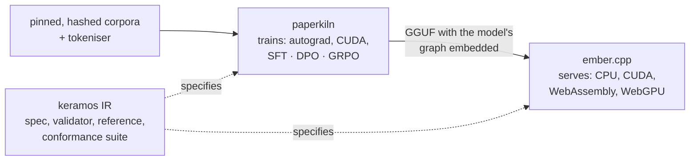

# paperkiln

**The training layer of a citizen-AI stack.**

Sovereign AI is a nation owning its models. Citizen AI is the same ownership at the scale of one
person or a small team: every layer of a language-model stack (tokeniser, trainer, graph format,
inference engine, evaluation) written, owned and checked by the people who use it, with no PyTorch
in the training or serving path and no open-weight base underneath. paperkiln is the training
layer: a from-scratch C++ trainer for small language models, with reverse-mode autograd and
hand-derived backwards, CUDA kernels and opt-in mixed precision. paperkiln trains; keramos
specifies the model graph, an IR both engines implement and test against one conformance suite;
ember.cpp serves. Citizen AI names how the stack is built. It is not a claim about scale or
quality: the models are small, and the results below say what they can and cannot do.



The working rules: every claim carries a receipt, negatives are published beside wins, and
experiments are registered (hypothesis, bar, seeds, budget) before they run. paperkiln was
formerly `microtorch`.

## What it has done

- **Base A, a chat base of our own.** An 8-layer, 768-wide Llama-style model, 72.76M unique
  parameters, pretrained from scratch on paperkiln for 60,000 steps of 16,384 positions
  (983M positions) on pinned corpora, then fine-tuned for chat. A registered race chose it over a
  12-layer arm. Shape and schedule: [`make_tc_b1.py`](https://github.com/JohnnyTeutonic/paperkiln/blob/ab15db97f1d7d4f032c4b66915e808b69824247f/tools/colab_chat/make_tc_b1.py);
  parameter count and lineage: [the programme registry, section 2](https://github.com/JohnnyTeutonic/paperkiln/blob/36523b27c93223a48cb10503adfc8bc6bf0a8c23/experiments/tiny_chat_programme/TINY_CHAT_RESEARCH_PROGRAMME.md#2-the-model).
- **A registered research programme on it.** The question: how much conversational coherence,
  salience and relevance a compute-constrained model of this size can reach, and which
  architecture, data and optimisation get there. Each screen (A6 to A29) registered its arms and
  bar before training and was read against that bar; the verdicts, negatives included, are in
  [the registry](https://github.com/JohnnyTeutonic/paperkiln/blob/36523b27c93223a48cb10503adfc8bc6bf0a8c23/experiments/tiny_chat_programme/TINY_CHAT_RESEARCH_PROGRAMME.md)
  (section 4 for each screen, section 7 for the capability frontier, section 9 for retractions).
  Scoped results are under [Results and limits](#results-and-limits).
- **Base 2, under way.** A deeper base, 18 × 512 (69.8M parameters), in three registered arms
  ([arm N's graph](https://github.com/JohnnyTeutonic/paperkiln/blob/428b60f0329de3dced1606e1f83fa73acc66be93/tools/colab_chat/base2_N.json)),
  running on Colab with checkpoints pushed to a private Hugging Face store, so a lost session does
  not lose the run. No results are claimed.
- **Earlier models.** pk_base_v1 (12 × 768) and its chat model pk_sft_v1 were trained here and
  published on the Hugging Face Hub ([CHANGELOG](CHANGELOG.md),
  [results](experiments/chat_general/RESULTS.md)); pk_sft_v1 runs
  [in the browser](https://huggingface.co/spaces/johnnyteutonic/ember-chat) through ember.cpp.

## What is in the engine

| Area | What it has | Detail |
|---|---|---|
| Model families | Llama, GPT-2, flex (any depth, norm, activation, positions), sliding-window attention, Mamba-style state space, mixture of experts, recursion and Mixture-of-Recursions, per-turn state tokens, attention residuals | [features](docs/FEATURES.md#engine-features) |
| Training | AdamW, SGD, Muon; gradient accumulation, checkpointing; LoRA and QLoRA; a device-resident CUDA step; BF16 and flash attention, opt-in | [GPU training](docs/FEATURES.md#gpu-training), [CUDA record](docs/CUDA_PHASE_B2.md) |
| Post-training | masked SFT, rejection SFT, GRPO, DPO + RPO, judged preference data | [POSTTRAIN.md](docs/POSTTRAIN.md) |
| Data | pinned corpora with ledgers and hashes, decontamination against the evaluation sets, a mixer with an annealing tail | [features](docs/FEATURES.md#engine-features) |
| Tokenisers | paperkiln's byte-level BPE; a 16k vocabulary in the Llama 3 scheme, checked id for id against llama.cpp, with a C++ encoder ported from llama.cpp | [features](docs/FEATURES.md#engine-features) |
| IR | keramos, vendored at a pinned tag: every op EXACT or ROUNDING, a validator, a numpy reference and a conformance suite | [spec/README.md](spec/README.md) |
| Export | safetensors, Hugging Face folders, GGUF (F32, Q8_0, Q4_0, Q4_K_M, Q4_K_S) with the tokeniser and the IR embedded | [export](docs/FEATURES.md#export-and-serve-anywhere) |
| Evaluation | Carry-5 and Carry-12 for conversational memory, seven standard benchmarks, greedy parity between the engines | [benchmarks](experiments/benchmarks_2026-10-26/RESULTS.md), [tour](docs/TOUR.md) |
| Studio | one JSON spec runs train, evaluate, export and serve; a dashboard with live loss and per-module gradients | [studio](#the-studio-and-the-arxiv-extractor) |

Gradient checks include finite differences for the differentiable primitives. What each feature
supports, and its numerical limits, is recorded beside its tests and receipts.

## Quick start

Chat with a model you train on your own CPU (Linux, macOS, or Windows through WSL2):

```bash
git clone https://github.com/JohnnyTeutonic/paperkiln.git && cd paperkiln
bash quickstart_chat.sh            # checks your tools, builds, trains (about 10 minutes), opens a chat page
bash quickstart_chat.sh --help     # --mode default skips training and uses the ready-made model
```

Train from a spec. One JSON file describes the run (`arch`, `data`, `train`, `export`, `serve`;
[the spec format](docs/TOUR.md#custom-configuration--the-spec-format), [examples](specs/)):

```bash
mkdir build && cd build && cmake .. -DCMAKE_BUILD_TYPE=Release && make -j mtstudio && cd ..
pip install huggingface_hub gguf transformers torch tokenizers safetensors   # data and parity tools
python tools/get_tinystories_data.py                    # a public corpus and vocabulary
./build/mtstudio plan specs/tinystories-llama-3k.json   # dry run
./build/mtstudio run specs/tinystories-llama-3k.json    # train, evaluate, export safetensors + GGUF
./build/mtstudio chat runs/tinystories-llama-3k --port 8080
```

Export again in other formats, then serve the GGUF in ember.cpp:

```bash
./build/mtstudio export specs/tinystories-llama-3k.json --formats gguf_q8_0_all,gguf_q4_k_m
cd .. && git clone https://github.com/JohnnyTeutonic/ember.cpp && cd ember.cpp
mkdir build && cd build && cmake .. -DHAS_CUDA=OFF && make -j
./tinyllama MODEL.gguf MODEL.gguf 4 prompt "once upon a time" --max-tokens 40 -ngl 0 --top-k 1 --raw-prompt
```

`MODEL.gguf` is the GGUF in the run's output folder, given twice because the model and its
vocabulary are one file.
[Chatting with an exported model](docs/CHAT_WITH_A_PAPERKILN_MODEL.md) covers the Python and
llama.cpp routes; [GPU training](docs/FEATURES.md#gpu-training) covers the CUDA build and its
switches; [C++ and Python](docs/FEATURES.md#c-and-python) shows the library API.

## The studio and the arXiv extractor

The studio is one browser tab over the same spec: build or load a spec, train with a live loss
curve and per-module gradients, export, and chat. Its from-paper flow takes an arXiv link.

**[Watch the 5-minute walkthrough](docs/media/demo_walkthrough.mp4)**: the whole loop, live and
unedited.


The LLM extractor (`papers/llm_extract.py`) sends a paper's LaTeX to Claude in one call and gets
back the architecture as an IR graph, with a verbatim quote for every value; a deterministic
verifier checks each quote against the source before anything trains, and anything unverified
makes the chain refuse rather than approximate. On the 40-paper benchmark its flavour verdicts
were 81 correct, 11 abstentions and 0 wrong, against 73, 19 and 0 for the rule-based extractor
([scores](papers/llm_extract_receipts/2026-10-27_bench_scores.json)). The rule-based extractor (`pip install paperkiln-fetch`) needs no API key.

```bash
python papers/llm_extract.py extract 2302.13971 --out llama.extraction.json   # needs ANTHROPIC_API_KEY
python tools/arxiv_to_chat.py 2302.13971 --extraction llama.extraction.json --run-dir runs/llama \
    --chat "Hello, how are you?"
```

Details, costs and the studio's research panels: [From an arXiv paper](docs/FEATURES.md#from-an-arxiv-paper-and-the-studios-panels).

## Results and limits

Each result holds under its own protocol and scale; none is a state-of-the-art claim.

- **A recipe that holds its guards at one seed, and a base that limits it.** On base A, S71's SFT
  recipe was the first to hold identity (80 of 92), role-play (6 of 48 breaks), no loops and
  relevance together (A26, `ready`). At a second seed it missed three of A26's bars (role-play
  breaks, loops and the ended twin; A28, `wide_only`), so `ready` is one seed's reading. As a
  diagnostic comparison, the same recipe on an open-weight 135M model read about 5 points higher
  on the wide judged read (J1) at two seeds (A29, `base_up`): on this evidence our base limits relevance, which is why base 2 exists.
  Adding a thread pool to S71's data lowered relevance at one seed and told recall at both (A27,
  `relevance_cost`). Registry section 4 holds these and every other screen's verdict.
- **In one protocol, size did not buy conversational memory.** At 20M, 60M and 150M
  non-embedding parameters and a fixed token budget, five seeds each, the carry score's slope
  with size is inside the registered equivalence interval, while language-model loss improves
  with size ([results](experiments/tiny_chat_2026-10/size/RESULTS.md)). At about 1 to 8 tokens
  per parameter this cannot separate under-training from a limit of scale.
- **Template SFT helped long conversations; per-turn state tokens hurt.** On Carry-12, adding
  human-written template SFT improved the carry metric by 9.16 points at three seeds; per-turn
  state tokens (S-gist) scored 12.7 points below the baseline at five seeds, as the registered
  contrast predicted ([results](experiments/tiny_chat_long_2026-10/RESULTS.md)).
- **pk_base_v1 against references.** Level with Pythia-160m on HellaSwag, ARC, PIQA and
  WinoGrande, below it on LAMBADA and BLiMP, and below SmolLM2-135M everywhere
  ([benchmarks](experiments/benchmarks_2026-10-26/RESULTS.md)).
- **Single-seed ablations are lottery tickets.** Five identical sliding-window experiments that
  differ only in seed disagree in sign at some budgets; the [crossing theorem](atlas/THEOREM_CROSSING.md)
  says why ([the exhibit](atlas/SEED_LOTTERY.md)).
- **Retractions stay on the record.** The [findings registry](atlas/FINDINGS.md) keeps retracted
  and superseded claims as rows, and the [sparse-attention record](docs/SPARSE_ATTENTION.md)
  publishes the mechanism that failed.

The engineering gates (CUDA kernels, host-read boundaries, BF16 attention, Mamba, Hugging Face
export parity) are bounded correctness results with their receipts in
[Engineering results and limits](docs/FEATURES.md#engineering-results-and-limits). Open work
is in [ROADMAP.md](ROADMAP.md).

## The stack, the name and the licence

- [keramos](https://github.com/JohnnyTeutonic/keramos): the IR's specification, vendored in
  [`spec/`](spec/) at the tag in `spec/KERAMOS_PIN.json`.
- [ember.cpp](https://github.com/JohnnyTeutonic/ember.cpp): the inference engine.
- [coalfire.cpp](https://github.com/JohnnyTeutonic/coalfire.cpp): the original C++ trainer.
- paperkiln was `microtorch` until 1 August 2026. GitHub redirects the old URL; the C++
  namespace and header paths keep the old name.
- [Every document](docs/README.md), [the full tour](docs/TOUR.md),
  [the API reference](https://johnnyteutonic.github.io/paperkiln/), [how to cite](CITATION.cff).

MIT licence, see [LICENSE](LICENSE).
