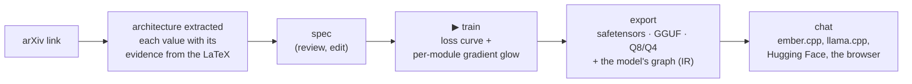
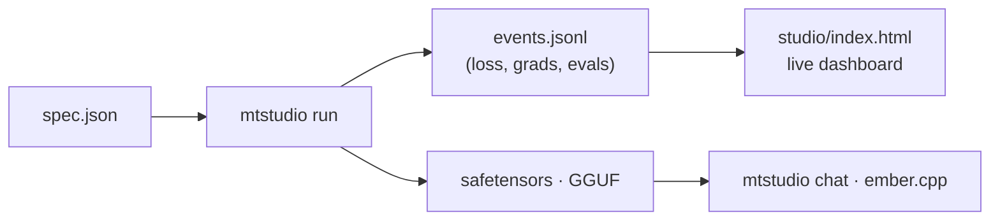

# paperkiln

**Drop an arXiv link on a page. Train the paper's actual architecture, not the nearest
preset. Watch its gradients glow layer by layer, export a GGUF, and chat with it. One browser
tab, one C++ stack you can read in an afternoon, and every claim carries its receipt.**

*Formerly `microtorch` (renamed 2026-08-01; GitHub redirects the old URL). The C++ namespace and
header paths keep `microtorch`. Sibling engines: [ember.cpp](https://github.com/JohnnyTeutonic/ember.cpp)
(inference) and [coalfire.cpp](https://github.com/JohnnyTeutonic/coalfire.cpp) (the original C++ trainer).*

**[▶ Watch the 5-minute walkthrough](docs/media/demo_walkthrough.mp4)**: the whole loop, live
and unedited. It shows the arXiv fetch on camera, the evidence view, training, export and chat.




## What it is

A readable C++ LLM training stack (reverse-mode autograd, hand-derived backwards, every op
finite-difference checked) that trains real architectures end to end, from paper to served
model. It has the habit of publishing its negatives next to its wins. The core engine (tape,
ops, layers, Llama family, quantisation, GGUF) is about 5,100 lines, and the whole stack runs
30 CTest suites plus the Python suites in CI.

| Area | What you get |
|---|---|
| **Model families** | Llama (RMSNorm, RoPE, SwiGLU), GPT-2, flex (any depth, norm, activation, positions; paper-faithful), sliding-window attention with sinks, Kimi linear attention, Mamba-style state space, SRD, AttnRes, highway, **mixture of experts** (top-k, load-balance + z-loss, sparse upcycling); on the Llama block: tied-block **recursion** and **Mixture-of-Recursions** (per-token depth, causal), **per-turn state tokens** (a turn-state attention mask, KV eviction of finished turns) and attention residuals across sublayers |
| **Conversations** | one schema for instruction tuning and chat (an instruction is a one-exchange conversation; a system message folds into the first user message); the loss policy declared per run (by default every assistant turn); the chat template written into every GGUF as a versioned record, with a generated `tokenizer.chat_template` and an Ollama Modelfile, so llama.cpp, LM Studio and Ollama prompt a 16k-vocabulary model exactly as paperkiln and ember.cpp do |
| **Runtime-defined ops** | a paper's new activation, gate or norm variant written as an `expr` (`"activation": "expr:max(x, 0)^2"`): parsed at runtime into differentiable primitives, gradient-checked, trained and exported as an IR node without recompiling; ember.cpp runs the same grammar. C++ vs the numpy reference within 1.2e-7 |
| **Any architecture, both directions** | every family exports its graph as IR; and standard llama.cpp GGUFs of Qwen2/Qwen3, Gemma 3, GPT-2, GPT-NeoX (Pythia), Mistral (sliding window) and Mamba-1 get an IR built from their metadata (`spec/tools/gguf_ir.py`), run by a numpy reference interpreter (`spec/tools/ir_numpy.py`) and gated against Hugging Face transformers (`tools/thirdparty_parity.py`: GPT-2 124M and Pythia-160m 40/40 greedy); ember.cpp runs them, Qwen2.5 and Qwen3 40/40 vs HF |
| **Training** | AdamW, SGD, **Muon**; warmup + cosine; mini-batching, gradient accumulation, checkpointing, fused attention; LoRA and QLoRA (int8); **CUDA** device-resident step (L4: 0.109 s/step at d384, from 6.4); **BF16 mixed precision** and flash attention, opt-in (`train.precision`, `train.attention_kernel`): 1.58x (20M) to 1.71x (60M) on an L4, with the final loss moved by about 1/40 of FP32's seed-to-seed spread |
| **Post-training** | masked SFT, rejection SFT, GRPO, DPO + RPO; AI-judged preference data: candidate replies sampled through ember (`tools/posttrain/sample_candidates.py`), a Claude judge ranking both orders under a hard cost cap, and a 200-prompt pilot (`experiments/chat_general/judge_pilot.sh`) |
| **Data** | pinned corpora with ledgers and hashes: FineWeb-Edu (shard 0; shards 1-3 are pinned on their first fetch), dialogue for pretraining (SODA, OpenAssistant, UltraChat, everyday-conversations; `corpus/fetchers/dialogue_pt.py`), a large SFT set from smol-smoltalk (`tools/lever1_sft.py`); the dialogue and SFT sources checked against the frozen eval sets (`corpus/decontam.py`); a two-part mixer with an annealing tail (`corpus/mix_pretrain.py`); pre-tokenised `.ids` corpora (`tools/corpus_ids.py`) |
| **Tokenisers** | paperkiln's byte-level BPE, and a llama.cpp-compatible vocabulary in the Llama 3 scheme: a trainer (`corpus/fetchers/vocab_llama3_bpe.py`) whose check compares ids with llama.cpp's own tokeniser, and an exact C++ encoder ported from llama.cpp (`include/microtorch/llama3_tokenizer.hpp`) |
| **The IR** | the graph format both engines share, specified in **keramos** (its own repository; vendored here at a pinned tag in [`spec/`](spec/), `spec/KERAMOS_PIN.json`): IR version 1, specification revision 1.1, with profiles core, state, recursion, chat, thirdparty and recurrence (a per-token state update declared in the document); every op EXACT (bit-identical on every backend) or ROUNDING (within a stated tolerance); the document's digest (RFC 8785 + SHA-256, `paperkiln.ir_sha256`); exact values for every stored tensor type; a JSON Schema, a validator, a numpy reference interpreter and a conformance suite that any engine joins through a JSON Lines adapter ([`spec/README.md`](spec/README.md)) |
| **Export** | safetensors (HF round trip), Hugging Face `from_pretrained` folders, GGUF with the tokeniser embedded, **Q8_0 and 4-bit (Q4_0, Q4_K_M, Q4_K_S) GGUFs** (byte-identical to the reference quantisers), and the **model graph as IR** in every GGUF, so [ember.cpp](https://github.com/JohnnyTeutonic/ember.cpp) runs every family |
| **Studio** | one JSON spec runs train → eval → export → serve; a zero-dependency dashboard with live loss, gradient glow, spec builder, architecture diagram, from-paper flow and chat |
| **From papers** | **LLM extractor** (`papers/llm_extract.py`): one Claude call reads the paper's LaTeX and returns the architecture as an IR op graph, new operations as runtime-defined `expr` ops, and a verbatim quote for every value; a deterministic verifier checks each quote against the source before anything trains. On the 40-paper benchmark: 82 correct, 9 abstain, 1 wrong, against the rule-based extractor's 72 / 20 / 0. The rule-based extractor (`papers/fetch.py` / `pip install paperkiln-fetch`, no API key) stays as the offline path |
| **Research tooling** | the Architecture Atlas (designed experiments, multi-seed cells, a findings registry with retractions), falsifiers built into the modules, one-command replication |

## What makes it different

1. **Papers in, running models out, with provenance.** An LLM reads the paper; every value it
   returns carries the sentence, equation or table cell it came from, and a deterministic check
   confirms that quote is in the LaTeX before the value is used. Unresolved fields are reported,
   never guessed, and a new operation the paper proposes comes back as an `expr` op both
   engines run without recompiling.
2. **The paper's architecture is what trains.** Depth, d_ff, norm, activation and positions
   are constructor-real. *Attention Is All You Need* trains as 512/6/8/2048 with LayerNorm,
   ReLU and sinusoidal positions.
3. **The extraction is measured.** A 40-paper benchmark with ground truth, CIs and a growth
   protocol scores both extractors side by side, with every call's tokens and cost receipted.
   Every wrong assertion it found is registered with its cause and fixed.
4. **Falsifiers ship inside the modules,** and failed claims are
   [published](docs/SPARSE_ATTENTION.md).
5. **The loop closes across two engines.** Models export to GGUF and run in ember.cpp, a
   separately written engine, with replies identical token for token. The live demo is
   [a model trained here](https://huggingface.co/spaces/johnnyteutonic/ember-chat), running in
   the browser.
6. **It runs designed experiments on itself.** The [findings registry](atlas/FINDINGS.md) holds
   35 findings, 3 retractions and 4 supersessions among them. 18 carry a manifest that
   `python tools/reproduce.py <id>` re-runs.

## Quick start: chat with your own model

```bash
git clone https://github.com/JohnnyTeutonic/paperkiln.git && cd paperkiln
bash quickstart_chat.sh
```

The script checks your tools (and tells you how to install anything missing), builds
paperkiln, makes a practice corpus, trains a model on your CPU (about 10 minutes for the Quick
preset), writes a plain-language model card and opens a chat page at http://127.0.0.1:8080. It
can also make a temporary public link. Linux, macOS and Windows through WSL2. `--mode default`
skips training and chats with the ready-made browser model. Scripted flags:
`--mode default|train --preset quick|better --share|--no-share --port N --yes|-y`.

## Quick start: train from a spec

```bash
mkdir build && cd build && cmake .. -DCMAKE_BUILD_TYPE=Release && make -j mtstudio && cd ..
pip install huggingface_hub gguf transformers torch tokenizers safetensors
python tools/get_tinystories_data.py                   # public corpus + vocabulary
./build/mtstudio run specs/tinystories-llama-3k.json   # train, eval, export safetensors + GGUF
./build/mtstudio chat runs/tinystories-llama-3k --port 8080
```

One JSON file describes the run (`arch`, `data`, `train`, `export`, `serve`): see
[specs/](specs/) and [the spec format](docs/TOUR.md#custom-configuration--the-spec-format).
`mtstudio plan` dry-runs it, and runs resume from their checkpoints.



## Quick start: from an arXiv paper

```bash
export ANTHROPIC_API_KEY=...                                        # the LLM extractor's only credential
python papers/llm_extract.py extract 2302.13971 --out llama.extraction.json
python tools/arxiv_to_chat.py 2302.13971 --extraction llama.extraction.json --run-dir runs/llama \
    --chat "Hello, how are you?"                                     # paper -> trained model -> chat
```

`llm_extract.py` sends the LaTeX in one call (about $0.3-0.5 a paper with Claude Opus), verifies
every quote, and writes the `extraction.json` that `tools/arxiv_to_chat.py` trains from; anything
unverified or outside the IR makes the chain refuse rather than approximate. Without an API key,
the rule-based extractor does the same job more conservatively:

```bash
pip install paperkiln-fetch
paperfetch 1706.03762                       # evidence-carrying architecture summary
paperfetch 2302.13971 --emit-hf cfg.json    # a Hugging Face config, citations inside
```

In the studio (`./build/mtstudio serve <out_dir> 8080`, then open the page), drag an arXiv link
onto the page. The extracted architecture fills the spec builder, the diagram redraws, and
▶ train runs in the same tab. Details: [the LLM extractor](docs/TOUR.md#paper-to-architecture-the-llm-extractor)
and [the rule-based fetcher](docs/TOUR.md#paper-to-architecture-the-rule-based-arxiv-fetcher-no-api-key).

## Quick start: export and serve anywhere

```jsonc
"export": { "formats": ["safetensors", "gguf", "gguf_q8_0_all", "gguf_q4_k_m"] }
```

`mtstudio export spec.json --from model.safetensors --formats ...` re-exports an existing
checkpoint. Every GGUF carries its tokeniser and the model's graph (`paperkiln.ir`).

- [ember.cpp](https://github.com/JohnnyTeutonic/ember.cpp) runs every family (CPU, CUDA,
  WebAssembly), and llama-family and MoE models on the visitor's GPU in the browser (WebGPU).
- llama.cpp runs the llama, MoE and gpt2 exports, given token ids. Models on the new Llama 3
  scheme vocabulary tokenise in llama.cpp, Ollama and LM Studio too.
- `python tools/hf_export.py <run> --hf-dir <dir>` turns a llama-family run into a folder that
  `transformers.from_pretrained` opens.

## Quick start: GPU

```bash
mkdir -p build && cd build && cmake .. -DCMAKE_BUILD_TYPE=Release -DMICROTORCH_CUDA=ON && make -j mtstudio && cd ..
export MICROTORCH_DEVICE=cuda MICROTORCH_DEVICE_OPS=1 MICROTORCH_ATTN_BLOCKED=1 MICROTORCH_CUBLAS=1
export MICROTORCH_STEP_RESIDENCY=1 MICROTORCH_DEFER_DOWNLOADS=1   # llama family only: leave out for gpt2
./build/mtstudio run spec.json
```

Each switch is opt-in. `MICROTORCH_DEVICE=cuda` on its own sends the matrix multiplies to the
GPU one call at a time; the full set runs the training step device-resident: resident tensors,
tiled attention, fused SwiGLU, clip and AdamW on the device, and MoE routing kernels. That way
d384 L6 trains at 0.109 s/step on an L4 (from 6.4), and d768 L12 at 2.1-2.3 s/step on a laptop
RTX 4060. Deferred downloads work for the llama family; the gpt2 family is still open
([CUDA_PHASE_B2.md](docs/CUDA_PHASE_B2.md)).

## Quick start: C++ and Python

```cpp
#include "microtorch/nn.hpp"
using namespace microtorch;
nn::GPT2 model(nn::GPT2Config{}, /*seed=*/42);
nn::AdamW opt(model.parameters(), 3e-4f);
Var loss = ops::cross_entropy(model.forward(ids), targets);
opt.zero_grad(); backward(loss); opt.step();
```

```bash
pip install paperkiln          # Linux x86-64 wheels, Python 3.10-3.12; import microtorch
```

## Research programme: tiny chat from scratch

How small can a language model be and still hold a conversation? This programme trains 5M-150M
parameter models from scratch for multi-turn chat with a little general knowledge, under rules
fixed before any run: **human-written text only** (13 pinned dialogue sources, no output from
larger models, no distillation), pre-registered hypotheses, seeds and analysis
([experiments/tiny_chat_2026-10/PREREGISTRATION.md](experiments/tiny_chat_2026-10/PREREGISTRATION.md)).

- **The benchmark measures carry, not fluency.** [Carry-5](docs/TOUR.md#evaluating-a-tiny-chat-model-carry-5)
  (1,032 items) plants a fact, a correction, a topic or a standing instruction early in a
  five-turn conversation and asks about it later, scored by forced choice. Each item also runs as
  a single-turn *twin* holding the same information, so the primary metric separates carrying
  context across turns from reading a fact once. Carry-12 (1,452 items, 12-14 turns) extends it to
  long conversations.
- **The questions.** How much dialogue the pretraining mix needs (E5: 0, 17, 35 and 70%); whether
  depth beats width at matched parameters for sequential, turn-by-turn reasoning (E1: 2 to 32
  layers at 20M and at 60M); whether reusing layers helps (tied-block recursion, and
  Mixture-of-Recursions with per-token depth); and whether early training ranks predict final
  ones. For long conversations: per-turn state tokens that let finished turns leave the KV cache,
  and attention over earlier layers' outputs (attention residuals).
- **Built for it, in both engines.** Recursion, Mixture-of-Recursions (causal token choice, so
  every token's depth is decided from what it has seen), per-turn state tokens with their
  attention mask and KV eviction, and attention residuals: each is in paperkiln's trainer, the IR
  spec ([`include/microtorch/ir.hpp`](include/microtorch/ir.hpp)) and ember.cpp's interpreter,
  gated token for token between the two.
- **Status (25 Oct 2026).** The floor pilot passed: a 20M model reads facts planted in a
  conversation (single-turn twin accuracy 0.53, chance 0.25, gate 0.35). E5, E1 at 20M and the
  recursion arm run on Colab; E1 at 60M runs on RunPod. The same pilot run on both providers
  matches bit for bit in pretraining. Arm X5 (attention residuals on the 20m_L16 llama, Jonathan's
  cross-layer idea, amendment 5) runs on RunPod: it trains at 0.67x the plain model's speed, and the
  plain path at its commit is bit-identical to E1's. Results land in the
  pre-registration's folder with their receipts.

## Research: what the methodology found

Run five copies of an identical experiment, varying only the seed. Does sliding-window
attention beat exact attention?

| budget (steps) | verdicts exact / swa | P(two one-seed labs contradict) |
|---:|:---:|:---:|
| 400 | 0 / 5 | 0% |
| 1600 | 1 / 4 | 32% |
| 2000-3600 | 3 / 2 | **48%** |

Single-seed ablations are lottery tickets ([the exhibit](atlas/SEED_LOTTERY.md)). The
[crossing theorem](atlas/THEOREM_CROSSING.md) explains why: for every finite seed budget there
is a band of training budgets where the comparison has no answer, and it narrows only as √n.
Findings live in [the registry](atlas/FINDINGS.md), each with effect, SE, scope and receipts.

```bash
python tools/atlas_findings.py render                 # the registry as a table
python tools/reproduce.py S3-lrxopt --run             # re-run a finding: REPLICATED / DID-NOT-REPLICATE
```

## In progress

- **Tiny chat from scratch** (above): E5, E1 and the recursion arm on Colab, E1 at 60M on
  RunPod; Carry-12 and its first stage follow E5 and E1.
- **The general chat model:** `pk_base_v1` (d768 L12, 97.5M parameters, 0.98B tokens on the
  16k Llama 3 scheme vocabulary) is trained and runs in ember; its fine-tune on the large SFT
  set, then DPO on Claude-judged pairs (pilot: 200 prompts). The MoE, dense-control and d768 L12
  fine-tunes are evaluated against the live model on the frozen chat prompts and the simple-QA
  probe.
- **After mixed precision:** a per-shape BF16 step profile decides the next speed-up: a fused
  LM head and cross-entropy, or fewer kernel launches per step.
- **Papers to models:** a gated or parameterised activation (DyT's learned alpha) in `expr`,
  post-norm placement and relative position biases; Claude-drafted primitives in both engines,
  accepted only through the same gates.

[ROADMAP.md](ROADMAP.md) has the full list.

## Learn more

| | |
|---|---|
| The full tour: studio, feature matrix, mechanisms, Atlas, fetcher, LoRA/QLoRA, CUDA, layout | [docs/TOUR.md](docs/TOUR.md) |
| Map of every document | [docs/README.md](docs/README.md) |
| Chatting with an exported model | [docs/CHAT_WITH_A_PAPERKILN_MODEL.md](docs/CHAT_WITH_A_PAPERKILN_MODEL.md) |
| What is left to do | [ROADMAP.md](ROADMAP.md) |
| API reference | [johnnyteutonic.github.io/paperkiln](https://johnnyteutonic.github.io/paperkiln/) (`doxygen docs/Doxyfile` builds it locally) |

## License

MIT, see [LICENSE](LICENSE).
